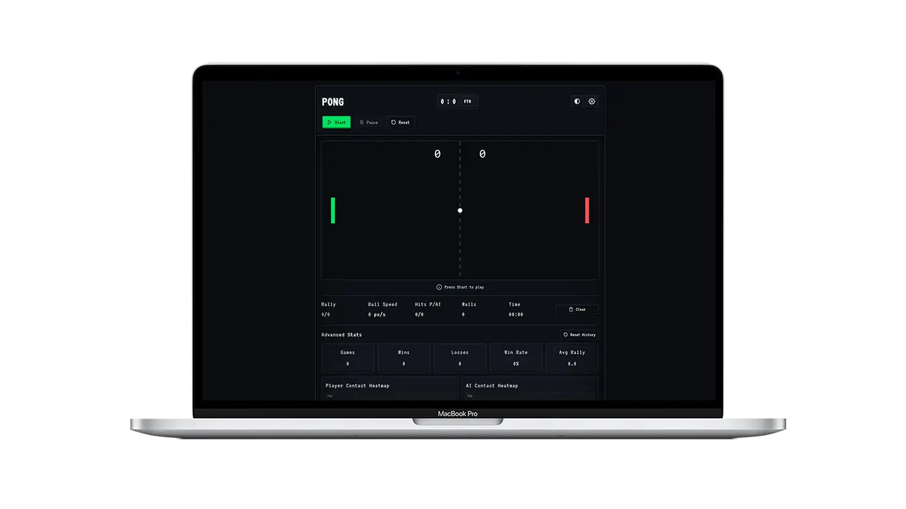

# Pong Game

A classic, web-based PONG game built with plain HTML, CSS, and JavaScript. Play as the left paddle against an AI opponent or a local friend in 2‑Player mode, with customizable settings, sound effects, and detailed gameplay stats.

## Features

- **Game flow:** Start, Pause/Resume, and Reset controls with on-screen buttons and keyboard shortcuts.
- **Score rules:** “First to” target (5, 10, or 15 points), shown on the scoreboard.
- **Game modes:** vs AI or 2 Players (Local). In 2P, right paddle is Player 2 (no AI).
- **Difficulty levels:** Easy, Medium, and Hard for the basic AI (vs AI mode).
- **Paddle speed:** Choose Slow, Normal, or Fast.
- **Ball speed modes:** Static or Gradual Acceleration with configurable "acceleration per hit".
- **Spin mechanics:** Optional spin when the ball hits the paddle, with adjustable spin intensity.
- **Assist mode:** Off (Classic), Light Assist, or Strong Assist to help with ball control.
- **Gamepad support:** Optional gamepad input with connection toasts. In 1P, the first gamepad controls Player 1; in 2P, the second gamepad controls Player 2.

### Controls

- **Auto-detect:** Mouse, Keyboard, or Touch.
- **Keyboard:**  
  - `Enter`: Start  
  - `P`: Pause/Resume  
  - `R`: Reset  
  - `W/S` or `Arrow Up/Down`: Move Player 1  
  - `I/K`: Move Player 2 (2P mode)
- **Option to invert the vertical axis.**
- **Mouse:** Move vertically to control the paddle (if selected)
- **Touch:** Drag vertically on mobile (if selected). In 2P mode, the canvas is split: left half controls P1, right half controls P2.
- **Gamepad (optional):** Enable in Settings. Left stick vertical controls paddle.  
  - 1P (vs AI): Gamepad #1 → Player 1  
  - 2P (Local): Gamepad #1 → Player 1, Gamepad #2 → Player 2

### Audio

- Toggle sound effects with a volume slider.
- Includes paddle hits, wall bounces, scoring, and match alerts.

### Display

- **Theme preference:** System, Light, or Dark.
- **High-DPI rendering toggle.**
- **Ball trail:** Adjustable intensity (Off/Low/Medium/High).
 - Dynamic opponent labels (AI or P2) and heatmap titles change based on game mode.

### Telemetry (in-match)

- Rally count, ball speed (px/s), player/AI hit counts, wall bounces, and elapsed time.

### Advanced stats (persistent)

- Games played, Wins, Losses, Win Rate, Average Rally.
- Player and AI contact heatmaps.
- Clear/Reset history actions.

## Settings

All settings are available in the “Game Settings” panel with tabs:

- **Gameplay:** Game Mode (vs AI / 2 Players), Difficulty (vs AI), Winning Score, Paddle Speed, Ball Speed Mode, Acceleration per Hit, Spin Effect & Spin Intensity, Assist Mode.
- **Controls:** Auto-Detect input method, Invert Vertical Axis, Gamepad Support toggle, and keyboard reference (includes P2 hotkeys).
- **Audio:** Sound Effects On/Off and Volume.
- **Display:** Theme (System/Light/Dark), High-DPI Rendering, Ball Trail Intensity, and Reset to Defaults.

## Persistence

The game remembers your preferences and advanced stats in your browser so your settings and history survive page reloads.  
You can clear per-match stats or reset the full history from the UI.

## Credits

Classic PONG (Atari, 1972) as inspiration.

## License
  
Licensed under the [MIT LICENSE](LICENSE).
